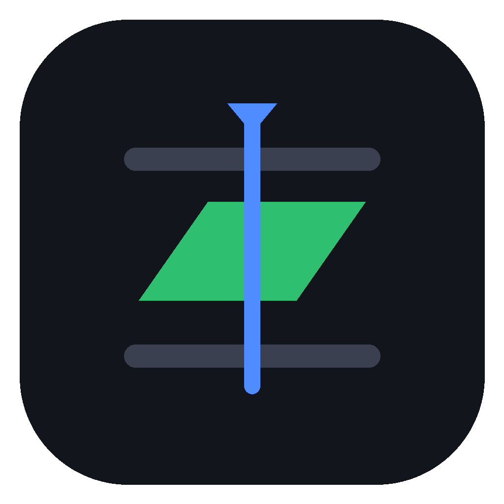
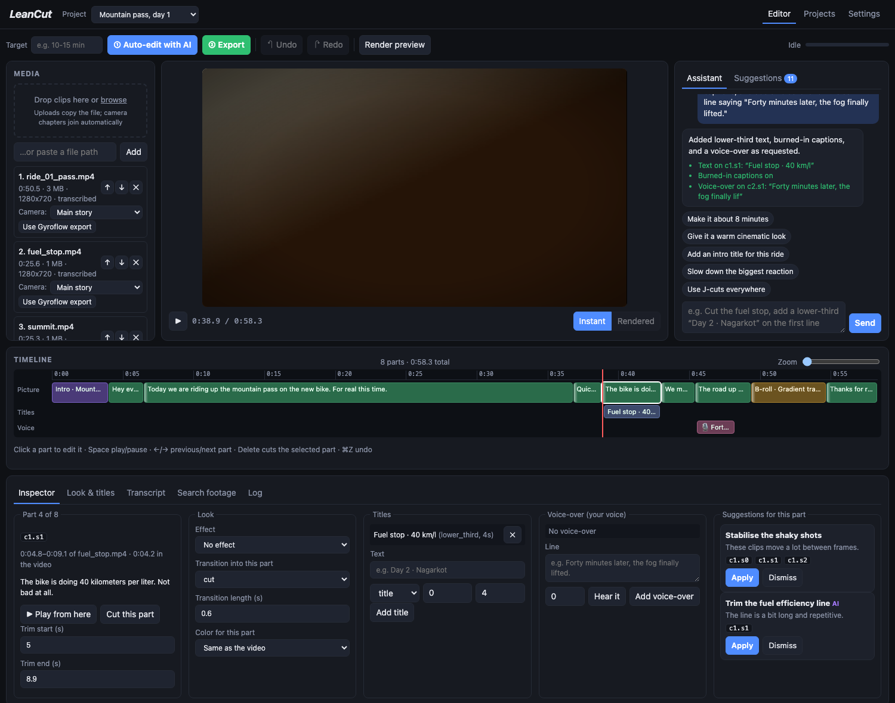
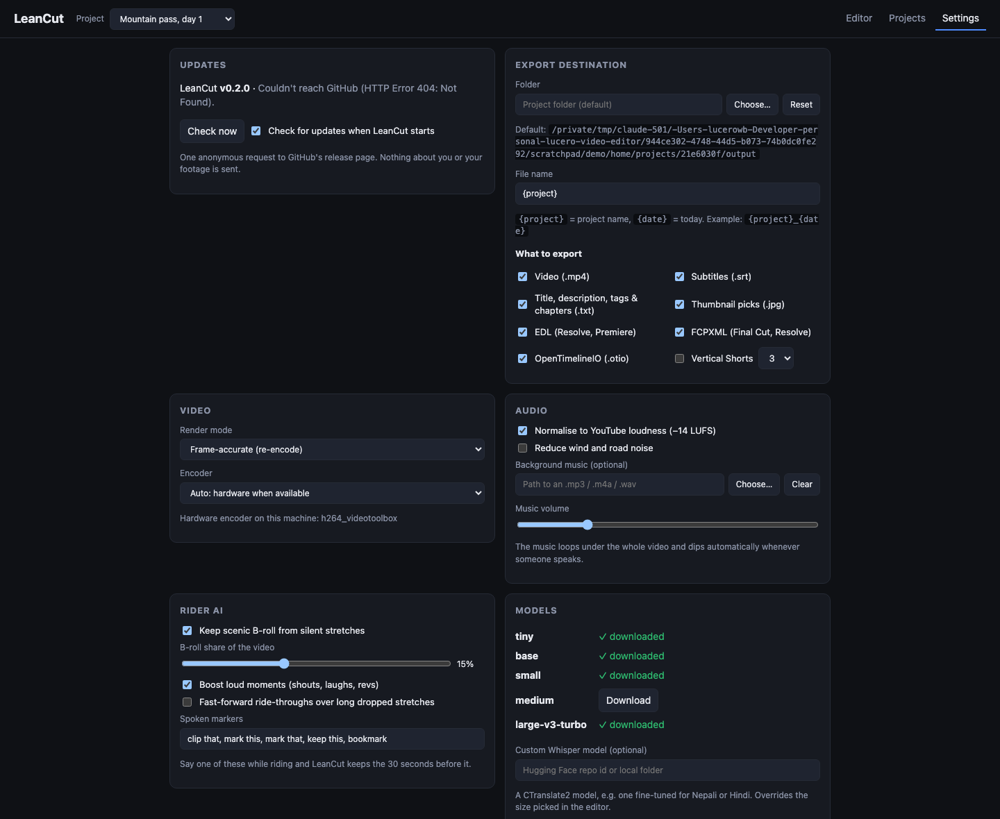
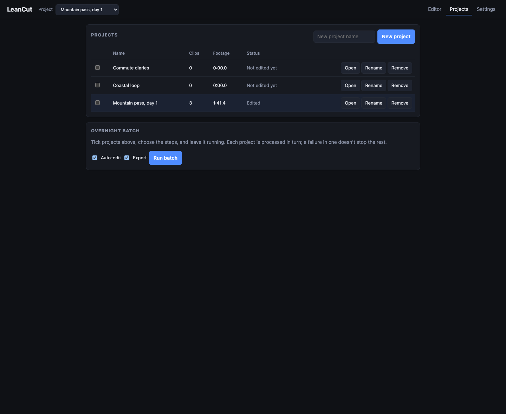

<div align="center">



# LeanCut

**Turn hours of moto-vlog and daily-vlog footage into a tight YouTube cut, with AI that runs entirely on your computer.**

[](https://github.com/lucerowb/leancut/actions/workflows/ci.yml)
[](LICENSE)


[Website](https://leancut.lucerowb.com/) · [User guide](https://leancut.lucerowb.com/guide.html) · [Download](https://github.com/lucerowb/leancut/releases/latest) · [Changelog](CHANGELOG.md) · [Architecture](ARCHITECTURE.md)



</div>

---

LeanCut listens to your footage, transcribes it, lets a language model on your own machine score every line, keeps
the best of it (plus the best silent scenery) up to the length you want, and renders the cut. Your footage, audio and
transcripts never leave your computer, and there's no account, subscription or upload.

Named after the lean angle through a corner, and a lean, tight edit.

## Features

- **AI edit, fully local.** faster-whisper transcribes; Ollama or LM Studio scores every line 1–5 with a reason; LeanCut's code keeps the best lines up to your target length. Timestamps always come from Whisper, never the LLM.
- **Built for rides:**
  - **Scenic B-roll keeper.** Silent stretches are scored for movement, colour and exposure; the best views fill a share you choose.
  - **Say "clip that".** A spoken marker keeps the 30 seconds before it; the command itself is cut.
  - **Loud moments.** Shouts, laughs and revs above the road noise lift a line's score.
  - **Ride-through fast-forwards** over long dropped stretches (optional).
- **Smarter cuts.** Retakes are detected (the earlier take goes), Whisper's repeat loops are cleaned up, fragments become whole thoughts, and every cut gets a 30 ms fade so it doesn't click.
- **Review before export.** A timeline and a scored transcript: tick, untick, preview, and drag the edges of any kept block to trim it.
- **Publish-ready output:** the MP4 at −14 LUFS, subtitles (`.srt`), a YouTube title, description, tags and valid chapters, six thumbnail picks, and vertical Shorts.
- **Finish in your editor.** EDL (Resolve, Premiere), FCPXML (Final Cut, Resolve) and OpenTimelineIO, on each camera's own timecode (drop-frame aware).
- **Sound.** Optional wind and road-noise reduction, and a music bed that ducks under speech.
- **Fast and resumable.** Hardware encoding (VideoToolbox, NVENC, Quick Sync, AMF) with GPU decoding. Cancel any time; a re-export reuses finished parts (28 s instead of 9 min in our 4K test).
- **Projects and an overnight batch queue**, plus **second-camera sync** by audio for multi-angle edits.
- **Settings page** for export destination and file names, formats, encoder, audio, rider AI, models and updates.
- **Update alerts.** One anonymous request to GitHub tells you when a new version is out. Turn it off in Settings › Updates.
- **No analytics, ads or accounts.** See the [privacy policy](https://leancut.lucerowb.com/privacy.html).

## Download

| Platform | File | Notes |
|---|---|---|
| macOS (Apple Silicon) | `LeanCut-macOS.dmg` | Drag LeanCut to Applications. Builds are unsigned for now: the first time, right-click → **Open**. |
| Windows 10/11 (64-bit) | `LeanCut-Windows.zip` | Extract and run `LeanCut.exe`. SmartScreen: **More info → Run anyway**. Needs the WebView2 runtime (built into Windows 11). |

Get them from [Releases](https://github.com/lucerowb/leancut/releases/latest). You also need a local language-model
server: [Ollama](https://ollama.com) (`ollama pull qwen2.5:7b`) or LM Studio (load a model → Developer → Start Server).
Pick a model that fits your memory; the [guide](https://leancut.lucerowb.com/guide.html#models) has a table.

## Screenshots

<p>
  
  
</p>

## Run from source

Requires **Python 3.10–3.12** (faster-whisper's CTranslate2 and onnxruntime wheels lag behind newer Pythons).

```bash
python3.12 -m venv .venv && source .venv/bin/activate     # Windows: .venv\Scripts\activate
pip install -r requirements.txt -r requirements-build.txt -r requirements-dev.txt
python desktop.py          # native window
python app.py              # or the browser UI at http://127.0.0.1:8765
python -m pytest -q tests  # tests (no models or network needed)
python build.py            # package: dist/LeanCut.app + .dmg, or dist/LeanCut + .zip on Windows
```

Data lives in `workspace/` when running from source, and in `~/Library/Application Support/LeanCut` (macOS) or
`%APPDATA%\LeanCut` (Windows) in the packaged app. `LEANCUT_HOME` overrides both.

## How it works

1. **Listen:** FFmpeg extracts 16 kHz mono audio; Silero VAD drops silence, wind and engine noise.
2. **Transcribe:** faster-whisper (`large-v3-turbo` by default) writes timecoded sentences; GPU when available, CPU fallback.
3. **Judge:** retakes, markers and loud moments are found in code; the local LLM scores the rest; `select()` fits the target length.
4. **Cut:** kept lines and B-roll are rendered (cached, cancellable), finished to −14 LUFS, and exported with edit lists, subtitles and YouTube text.

Details, including the security model and timecode handling, are in [ARCHITECTURE.md](ARCHITECTURE.md).

## Contributing

Issues and pull requests are welcome; see [CONTRIBUTING.md](CONTRIBUTING.md). Please report security problems
privately, as described in [SECURITY.md](SECURITY.md).

## License

[MIT](LICENSE). The packaged apps bundle FFmpeg (GPL v2 or later) and other open-source components; see
[THIRD_PARTY_NOTICES.md](THIRD_PARTY_NOTICES.md).
